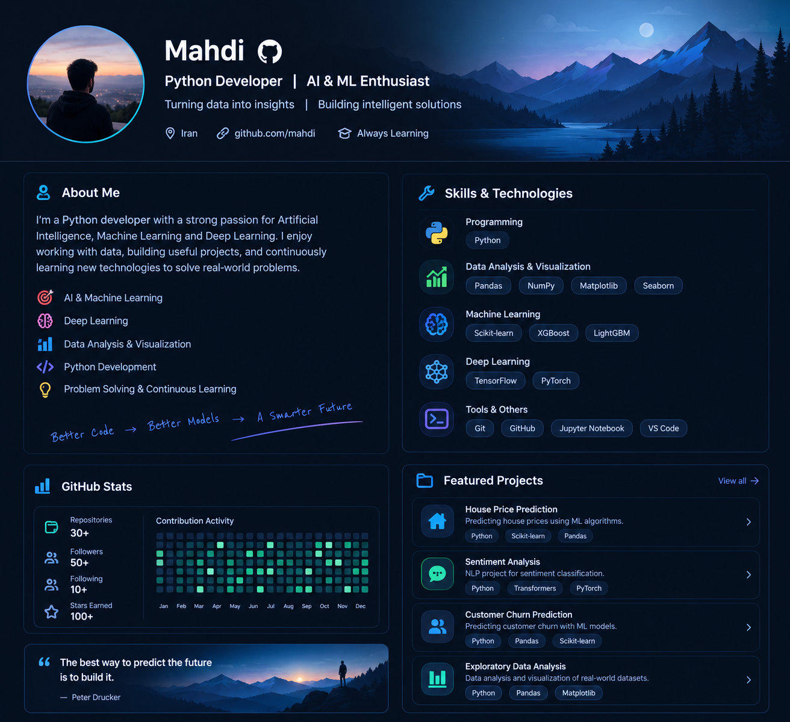

<!--
  GitHub Profile README for Mahdi
  1) Create a PUBLIC repository whose name exactly matches your GitHub username.
  2) Upload this README.md and profile-banner.png to its root.
  3) Replace YOUR_GITHUB_USERNAME everywhere below with your actual username.
  4) Remove any tools/skills you haven't used yet.
-->

 

  
  
  

---

## 👨‍💻 About Me

Hi, I'm **Mahdi** — a Python developer and an enthusiastic learner in **Artificial Intelligence, Machine Learning, Deep Learning, and Data Analysis**.

I enjoy turning raw data into useful insights, understanding the mathematics behind machine learning, and building practical projects that help me learn by doing.

- 🐍 **Programming:** Python
- 📊 **Data:** Data cleaning, exploratory data analysis (EDA), and visualization
- 🤖 **AI/ML:** Learning model development, evaluation, and predictive analytics
- 🧠 **Current focus:** Strengthening my foundations in statistics, probability, and machine learning
- 🌱 **Mindset:** Learn the fundamentals, build projects, improve continuously

## 🧰 Tech Stack

### Languages & Data

### Machine Learning & Tools

  
  
  

## 🚀 Featured Work

> Replace the examples below with links to your real repositories when they're ready. It's better to showcase a few clear, well-documented projects than to list projects that aren't yours.

| Project idea | What it demonstrates |
|---|---|
| **Exploratory Data Analysis** | Data cleaning, visualizations, and insights from a real dataset |
| **Machine Learning Regression** | Preprocessing, model training, evaluation, and comparison |
| **Classification Project** | Feature engineering, classification metrics, and error analysis |

<!-- Example project cards: replace REPO_NAME with an actual repository name

  

-->

## 📈 GitHub Overview

  
  

  

## 🎯 Goals

- Build a strong foundation in Python, statistics, and probability
- Create practical projects in data analysis and machine learning
- Learn deep learning concepts step by step
- Share my learning journey and projects openly

### *Learn continuously. Build thoughtfully. Make data useful.*

